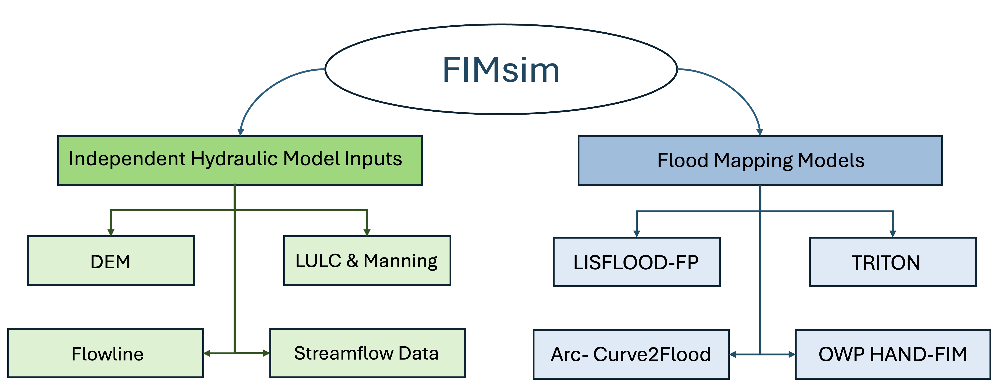

# FIMsim — Flood Inundation Model Simulation Tool

> **v1.0** · Web Application · Desktop installers available for macOS and Windows

FIMsim is a web-based tool designed to eliminate the technical barrier of setting up 2D flood simulations. It serves two distinct purposes: **(1) automated preparation of individual hydraulic model input data** — including terrain, land cover, river networks, and streamflow time series — and **(2) end-to-end configuration and cloud execution of complete flood mapping simulations** for four supported flood mapping models (LISFLOOD-FP, TRITON, ARC-Curve2Flood, and OWP HAND-FIM). Users define a study area, and FIMsim handles all data downloading, processing, and file formatting automatically. For users who prefer a local setup, standalone desktop installers for macOS and Windows are also available — no Python installation or technical configuration required.

---

## What the app does

FIMsim addresses two separate but related challenges in flood modeling:

**1. Preparing individual model inputs independently:**
Hydrologists often need specific geospatial datasets — a DEM for one project, LULC for another, streamflow records for analysis — without running a full simulation. FIMsim provides four standalone tools that each produce one type of input file in different formats, ready to use in any model or workflow.

**2. Running a complete flood simulation end to end:**
When the goal is a full flood inundation map, FIMsim can take over the entire pipeline. After the user defines a study area, it downloads every required input, writes all model-specific configuration files, and submits the simulation to run on cloud infrastructure — no local software installation or GIS expertise required.

| Track | What it does |
|---|---|
| **Independent Hydraulic Model Inputs** | Four standalone tools for downloading and processing individual geospatial inputs (DEM, LULC & Manning's n, Flowlines, Streamflow Data), each usable independently of any specific flood model |
| **Flood Mapping Models** | Four complete flood-mapping pipelines — each downloads all required inputs, writes all model files, and runs the simulation on cloud infrastructure |

---

## Workflow overview



---

## Data sources

FIMsim connects to the following public data services. An internet connection is required during data downloads.

| Dataset | Provider | Coverage |
|---|---|---|
| Digital Elevation Model (DEM) | USGS 3DEP (1 m, 10 m, 30 m) | USA |
| Height Above Nearest Drainage (HAND) | TACC | USA |
| Land Use / Land Cover (LULC) | NLCD — USGS | USA |
| Land Use / Land Cover (LULC) | Sentinel-2 — Esri | Global |
| River flowlines | NHD — USGS | USA |
| USGS stream gages | USGS Water Services | USA |
| Streamflow time series | NWM Retrospective v2.1 — NOAA | USA · 1979–2020 |
| Streamflow forecast | NWM Operational — NOAA | USA · ~10-day horizon |

---

## Supported flood models

| Model | Type | Input files generated |
|---|---|---|
| **LISFLOOD-FP** | 2D raster-based | `.par` · `.bci` · `.bdy` · DEM and Manning ASCII grids |
| **TRITON** | 2D GPU-accelerated | `.cfg` · `.extbc` · `.hyg` · DEM and friction ASCII grids |
| **ARC-Curve2Flood** | Rapid rating-curve flood mapping | NenCarta input package — configuration JSON · DEM · land-cover raster · Manning's n table · flowlines · streamflow |
| **OWP HAND-FIM** | HAND-based inundation mapping | Flood inundation maps generated directly from the AOI (HUC8 → NWM discharge → FIM) |

---

## Key features

- **Multi-AOI batch processing** — define multiple study areas in a single shapefile or GeoPackage; all downloads and outputs are handled per AOI automatically
- **Editable Manning's n table** — the LULC step generates a land-cover lookup table with Min / Avg / Max roughness values that the user can edit before export
- **Upstream / downstream detection** — the flowline step automatically identifies the upstream and downstream endpoints of the main river and marks them on the map
- **Map preview** — at each step, the app plots the results for visual inspection before saving

---

## Getting started

### Web application
FIMsim is deployed as a web application — no installation required. Open it in any browser and start a project immediately.

> 🔗 **Live app:** *(link coming soon)*

### Desktop installers
For users who prefer a local installation, standalone installers are available on the [Releases](../../releases) page — no Python or conda setup required.

| Platform | File |
|---|---|
| macOS | `FIMsim-mac.dmg` — drag to Applications |
| Windows | `FIMsim-setup-windows.exe` — run installer wizard |

### Run from source (contributors)

**Requirements:** [Anaconda or Miniconda](https://docs.conda.io/en/latest/miniconda.html),
`git`, and about 8 GB of free disk space. The environment is named **`FIMsim`**.

```bash
git clone https://github.com/pnikrou/FIMsim.git
cd FIMsim

# Step 1 - the core: geospatial stack, NWM/S3 libraries, GUI
# (everything LISFLOOD-FP and TRITON need)
conda env create -f environment.yml
conda activate FIMsim

# Step 2 - the OWP HAND-FIM and ARC-Curve2Flood backends
python -m core.deps --fix

# Check it: must print "Environment OK"
python -m core.deps

python main.py
```

Step 2 downloads about 400 MB (`pyspark`, which fimserve needs, installs from
source) and clones three small GitHub repositories, so allow ten minutes and keep
`git` on your PATH. It is safe to run again.

**Why two steps, and why not just `pip install`?** `fimserve` requires
`teehr==0.5.0`, and TEEHR pins `zarr<3`, `s3fs<2026` and `fsspec<2026`, while FIMsim
runs on `zarr 3` and `s3fs 2026`. No pip resolver can satisfy both: it either
deadlocks (backtracking through dozens of old fimserve releases and downloading the
450 MB pyspark tarball on the way) or "succeeds" by *downgrading* zarr and s3fs,
which breaks every NWM download. Step 2 therefore installs a fully pinned list
(`requirements-pip.txt`) with `--no-deps`, which leaves the verified conda stack
untouched. TEEHR is only used for its NWM fetch helpers and works on the newer
libraries.

> **Do not install packages into this environment one at a time.** An environment
> assembled by hand *opens FIMsim normally* and then fails partway through a
> workflow - typically `zarr and s3fs are required for NWM retrospective download`
> after an AOI and date range have already been chosen. `pip install -r
> requirements.txt` is deliberately blocked for the same reason.

**If something is wrong,** `python -m core.deps` lists exactly what is missing and
the command that fixes it, and FIMsim runs a quick version of the same check every
time it starts. To start over:

```bash
conda deactivate
conda env remove -n FIMsim
conda env create -f environment.yml
conda activate FIMsim
python -m core.deps --fix
```

**ARC-Curve2Flood: the first run after an install differs slightly.** ARC's
numba-compiled code gives different bathymetry, and therefore different flood maps,
on its first run in an environment (whenever numba's compile cache is empty) than
on every later run. On one small test case that was 1.1% of the bathymetry cells
(590 of 54,780) and about the same share of the flood-depth raster; every later
run matched the project's original results to the last cell. It happens in any
environment, including a long-lived one, and again after reinstalling `arc`,
`curve2flood` or `nencarta`. So after installing, **run one throwaway ARC case
before producing results you intend to keep.** Which of the two results is
numerically correct has not been determined; it should be reported to the ARC
authors.

Versions are pinned to the ones this release was verified with (for example
`pandas 2.3.3`: pandas 3 breaks pyspark, which HAND-FIM needs). Upgrade one at your
own risk and re-run `python -m core.deps`. `ARC` is pinned to a specific commit; it
is a few commits behind the authors' latest, which is the version the results in
this project were produced with.

---

## 🧪 Try it — no input data needed

Don't have a study area of your own? The [**`test_case/`**](test_case) folder ships two
ready-to-use AOI shapefiles with complete step-by-step walkthroughs — you provide the
AOI polygon and the event start/end dates; FIMsim downloads everything else
automatically.

| Test case | Location | Model | Flood event |
|---|---|---|---|
| [AOI 1](test_case) | Neuse River, North Carolina | LISFLOOD-FP | Hurricane Matthew (Oct 2016) |
| [AOI 2](test_case) | Village Creek, Texas | TRITON | Hurricane Harvey (Aug 2017) |
| [AOI 3](test_case) | Lumber River, North Carolina | Standalone input tools | Hurricane Matthew (Oct 2016) |

Each walkthrough includes a screenshot of every step and states the expected result
(detected river, USGS gage, generated files) so you can verify your installation is
working correctly.


